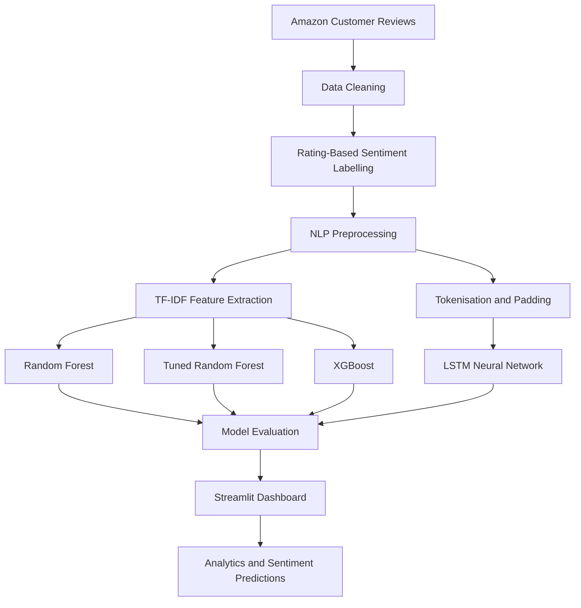

 <div align="center">


### Turn thousands of customer reviews into actionable sentiment insights.


[](https://www.python.org/)


</div>

---

## Overview

**MarketMind-AI** is a machine-learning-powered customer sentiment analysis platform designed to transform Amazon customer reviews into meaningful insights about product satisfaction and customer perception.

The project combines natural language processing (NLP), classical machine learning, deep learning, and interactive data visualisation. It classifies customer reviews into three sentiment categories—Negative, Neutral, and Positive—and provides an interactive Streamlit dashboard for exploring review patterns, comparing model performance, and predicting sentiment for new reviews.

## Project at a glance

| Metric | Value |
|---|---:|
| Cleaned customer reviews | 42,740 |
| Sentiment categories | 3 |
| Models evaluated | 4 |
| Test-set size | 8,548 |
| Best recorded test accuracy | **95.45%** |

## Dataset and sentiment classification

The dataset contains Amazon customer reviews labelled according to their star ratings.

- **Negative:** 1–2 stars
- **Neutral:** 3 stars
- **Positive:** 4–5 stars

### Sentiment distribution

| Sentiment | Number of reviews | Percentage |
|---|---:|---:|
| Positive | 17,923 | 41.9% |
| Negative | 14,349 | 33.6% |
| Neutral | 10,468 | 24.5% |
| **Total** | **42,740** | **100%** |

## Model performance

Four model configurations were evaluated to compare their ability to classify customer reviews. The reported test results use a held-out dataset of 8,548 reviews.

| Model | Feature representation | Accuracy | Precision | Recall | F1-score |
|---|---|---:|---:|---:|---:|
| Random Forest | TF-IDF | 94.01% | 95% | 94% | 94% |
| Tuned Random Forest | TF-IDF | ~94% | 95% | 94% | 94% |
| XGBoost | TF-IDF | 94.69% | 94.96% | 94.69% | 94.72% |
| **LSTM** | Token sequences | **95.45%** | **96%** | **95%** | **95%** |

### Key findings

- **LSTM:** Achieved the highest recorded test accuracy of 95.45%, with a test loss of 0.1602.
- **XGBoost:** Achieved 94.69% test accuracy, making it the strongest classical model in the reported results.
- **Random Forest:** Provided a strong baseline using TF-IDF text features.
- **Tuned Random Forest:** Achieved 93.84% cross-validation accuracy using three-fold `GridSearchCV`.

### Random Forest hyperparameters

The selected configuration was:

```python
{
    "n_estimators": 100,
    "max_depth": None,
    "min_samples_split": 5,
    "min_samples_leaf": 1
}
```

## Features and capabilities

### 1. Customer review exploration

- Browse and filter reviews by sentiment.
- Inspect raw and processed review datasets.
- Compare star-rating and sentiment distributions.
- Analyse review-length patterns across sentiment categories.

### 2. Interactive sentiment analytics

- Visualise the percentage of positive, negative, and neutral reviews.
- Explore rating behaviour and geographic review volume where location data is available.
- Analyse customer feedback through interactive Plotly charts.
- Identify broad customer satisfaction trends.

### 3. Sentiment prediction

- Enter a customer review for analysis.
- Select among Random Forest, tuned Random Forest, XGBoost, and LSTM.
- View the predicted sentiment and confidence score.
- Compare inference times across the available models.

### 4. Model comparison

- Compare classical machine-learning approaches with an LSTM neural network.
- Evaluate models using accuracy, precision, recall, and F1-score.
- Examine the impact of TF-IDF features and token sequences on classification performance.

## Methodology and workflow



### NLP pipeline

1. **Data cleaning:** Remove incomplete review records and prepare the dataset for analysis.
2. **Sentiment labelling:** Convert star ratings into negative, neutral, and positive categories.
3. **Text normalisation:** Standardise review text and expand contractions.
4. **Text cleaning:** Remove punctuation, numbers, and stopwords while preserving negation.
5. **Lemmatisation:** Reduce words to their base forms.
6. **TF-IDF feature extraction:** Convert text into numerical features for classical machine-learning models.
7. **Tokenisation:** Represent review text as sequences of tokens.
8. **Sequence padding:** Standardise sequence lengths for LSTM input.
9. **Model training and evaluation:** Train models and compare their predictive performance.
10. **Application integration:** Load trained model artifacts for sentiment inference through the Streamlit interface.

## Technology stack

| Category | Technologies |
|---|---|
| Programming language | Python 3.11 |
| Web application | Streamlit |
| Data processing | Pandas, NumPy |
| Natural language processing | NLTK, Contractions |
| Feature extraction | TF-IDF, tokenisation, sequence padding |
| Classical machine learning | Scikit-learn, Random Forest |
| Gradient boosting | XGBoost |
| Deep learning | TensorFlow, Keras, LSTM |
| Visualisation | Plotly, Matplotlib, Seaborn |
| Model optimisation | GridSearchCV |
| Deployment | Streamlit Community Cloud |
| Version control | Git, GitHub |

## Repository structure

```text
MarketMind-AI/
├── app.py                  # Main Streamlit application
├── prediction_utils.py     # Shared prediction utilities
├── pages/                  # Dashboard and model pages
├── notebooks/              # Data cleaning, EDA and experiments
├── models/                 # Trained model artifacts
├── data/                   # Raw and processed datasets
├── requirements.txt        # Python dependencies
└── pyproject.toml           # Project configuration
```

## Installation and local setup

### Prerequisites

- Python 3.11
- Git
- pip or uv

### Step 1: Clone the repository

```bash
git clone https://github.com/ni-saantt/MarketMind-AI.git
cd MarketMind-AI
```

### Step 2: Create a virtual environment

```bash
python -m venv .venv
```

Activate it on Windows PowerShell:

```powershell
.venv\Scripts\Activate.ps1
```

On macOS or Linux:

```bash
source .venv/bin/activate
```

### Step 3: Install dependencies

```bash
pip install -r requirements.txt
```

### Step 4: Run the application

```bash
streamlit run app.py
```

Open the local URL displayed in the terminal to access the application.

### Alternative setup using uv

```bash
uv venv .venv --python 3.11
uv pip install -r requirements.txt
uv run streamlit run app.py
```

## Author

**Nishant Choudhary**

B.Tech Computer Science and Engineering — Data Science  
Manipal University Jaipur

- GitHub: [ni-saantt](https://github.com/ni-saantt)
- LinkedIn: [ni-santt](https://linkedin.com/in/ni-santt)

## Limitations

- Sentiment labels are inferred from star ratings rather than independently annotated review text.
- Sarcasm, mixed opinions, and domain-specific expressions can result in incorrect predictions.
- Confidence scores should not be interpreted as calibrated probabilities of business risk.
- Model performance may vary across marketplaces, product categories, and customer populations.
- High test accuracy alone does not guarantee equivalent performance in a production environment.

## Future enhancements

- **Aspect-based sentiment analysis:** Identify sentiment associated with specific product attributes, such as quality, durability, pricing, and delivery.
- **Transformer-based models:** Evaluate DistilBERT and other transformer architectures against the existing LSTM baseline.
- **Model explainability:** Highlight words and phrases that influence sentiment predictions.
- **Error analysis:** Investigate misclassified reviews and performance across sentiment categories.
- **Expanded evaluation:** Validate performance on additional datasets and product categories.
- **Production monitoring:** Introduce confidence calibration and ongoing model-performance monitoring.

---

<div align="center">

### MarketMind-AI

**Turning customer feedback into actionable product insights through machine learning.**

Built with Python, natural language processing, machine learning, and Streamlit.

</div>
