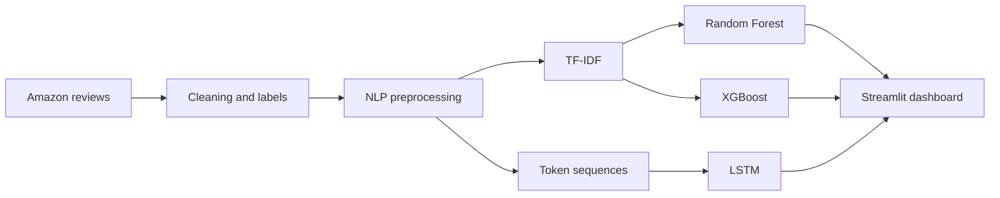

<div align="center">


### Turn thousands of customer reviews into clear, actionable sentiment insights.

[](https://aicw-insightcart.streamlit.app/)
[](https://github.com/nupoor-mahajan/InsightCart)


</div>

---

## The problem

Customer reviews contain signals about satisfaction, recurring complaints and product perception, but manually reading thousands of reviews is slow and inconsistent.

**InsightCart** converts unstructured Amazon customer feedback into sentiment predictions and interactive visual summaries. It classifies reviews as **Negative**, **Neutral** or **Positive**, compares four machine-learning approaches, and exposes the results through a deployed Streamlit dashboard.

## Project at a glance

| Dataset | Classes | Models compared | Best test accuracy |
|---|---:|---:|---:|
| 42,740 cleaned reviews | 3 | 4 | **95.45%** |

The sentiment labels were derived from review ratings:

- **1–2 stars:** Negative
- **3 stars:** Neutral
- **4–5 stars:** Positive

### Class distribution

| Sentiment | Reviews | Share |
|---|---:|---:|
| Positive | 17,923 | 41.9% |
| Negative | 14,349 | 33.6% |
| Neutral | 10,468 | 24.5% |

---

## Model performance

All reported values below come from the executed project notebooks. The test set contains **8,548 reviews**.

| Model | Representation | Accuracy | Precision | Recall | F1-score |
|---|---|---:|---:|---:|---:|
| Random Forest | TF-IDF | 94.01% | 95% | 94% | 94% |
| Tuned Random Forest | TF-IDF | ~94% | 95% | 94% | 94% |
| XGBoost | TF-IDF | 94.69% | 94.96% | 94.69% | 94.72% |
| **LSTM** | Token sequences | **95.45%** | **96%** | **95%** | **95%** |

> **Best model:** The LSTM achieved the highest recorded test accuracy at **95.45%** with a test loss of **0.1602**. XGBoost was the strongest classical model at **94.69%** accuracy.

The tuned Random Forest recorded **93.84% cross-validation accuracy** using 3-fold `GridSearchCV`. Its selected parameters were:

```python
{
    "n_estimators": 100,
    "max_depth": None,
    "min_samples_split": 5,
    "min_samples_leaf": 1
}
```

---

## What InsightCart can do

### Explore the dataset

- Browse and filter customer reviews by sentiment
- Inspect the raw and processed datasets
- Compare sentiment and rating distributions
- Analyse review length across sentiment classes

### Discover patterns

- View overall sentiment percentages
- Explore rating behaviour and geographic review volume
- Inspect dataset summaries through interactive Plotly charts
- Identify broad customer-satisfaction patterns

### Predict sentiment

- Enter a new customer review
- Run inference using Random Forest, tuned Random Forest, XGBoost or LSTM
- Receive the predicted sentiment and confidence score
- Compare model inference times

---

## How it works



### NLP pipeline

1. Remove incomplete review records
2. Convert ratings into three sentiment classes
3. Normalise text and expand contractions
4. Remove punctuation, numbers and stopwords while preserving negation
5. Lemmatise cleaned tokens
6. Create TF-IDF features for classical models
7. Tokenise and pad sequences for the LSTM
8. Evaluate, serialize and serve the trained models

---

## Technology stack

| Area | Technologies |
|---|---|
| Application | Python 3.11, Streamlit |
| Data processing | Pandas, NumPy |
| NLP | NLTK, Contractions, TF-IDF |
| Machine learning | Scikit-learn, XGBoost |
| Deep learning | TensorFlow, Keras, LSTM |
| Visualisation | Plotly, Matplotlib, Seaborn |
| Deployment | Streamlit Community Cloud |

---

## Repository structure

```text
InsightCart/
├── app.py                  # Streamlit entry point
├── prediction_utils.py     # Shared prediction helpers
├── pages/                  # Dashboard and model screens
├── notebooks/              # Cleaning, EDA and model experiments
├── models/                 # Trained model artifacts
├── data/                   # Raw and processed datasets
├── requirements.txt
└── pyproject.toml
```

---

## Run locally

### 1. Clone the repository

```bash
git clone https://github.com/nupoor-mahajan/InsightCart.git
cd InsightCart
```

### 2. Create and activate a virtual environment

```bash
python -m venv .venv
```

Windows PowerShell:

```powershell
.venv\Scripts\Activate.ps1
```

macOS or Linux:

```bash
source .venv/bin/activate
```

### 3. Install dependencies and start the dashboard

```bash
pip install -r requirements.txt
streamlit run app.py
```

### Alternative: use `uv`

```bash
uv venv .venv --python 3.11
uv pip install -r requirements.txt
uv run streamlit run app.py
```

---

## My contribution

**Nupoor Mahajan**

- Trained and evaluated the XGBoost sentiment classifier
- Designed and trained the LSTM deep-learning model
- Integrated trained artifacts into the Streamlit application
- Managed the GitHub repository and deployment workflow
- Deployed the application on Streamlit Community Cloud

## Team

| Member | Contribution |
|---|---|
| [Nupoor Mahajan](https://github.com/nupoor-mahajan) | XGBoost, LSTM, repository management and deployment |
| [Akshata Naik](https://github.com/NaikAkshata30) | Data cleaning, EDA, Random Forest, presentation and documentation |
| [Hansa Gusaiwal](https://github.com/hansagusaiwal) | NLP preprocessing, tuned Random Forest and documentation |

---

## Limitations

- Sentiment labels are inferred from star ratings rather than manually annotated review text.
- The model may struggle with sarcasm, mixed sentiment and domain-specific language.
- Confidence scores should not be treated as calibrated business-risk probabilities.
- Results are based on the current Amazon review dataset and may not generalise to every marketplace or product category.

## Next steps

- Add aspect-based sentiment analysis for product features and service issues
- Evaluate transformer models such as DistilBERT against the current LSTM baseline
- Add error analysis and model-explanation views to the dashboard

---

## Academic context

InsightCart was developed as a capstone project for **AICW by Edunet**, sponsored by **Microsoft** and **SAP**.

The project uses open-source libraries and an Amazon reviews dataset for educational purposes. No standalone software licence has currently been declared for the repository.

## Acknowledgements

Amazon Reviews Dataset · Kaggle · Streamlit · TensorFlow · Scikit-learn · XGBoost · NLTK · Open-source community

---

<div align="center">

**Built to explore how machine learning can turn customer feedback into clearer product decisions.**

[](https://aicw-insightcart.streamlit.app/)

</div>


